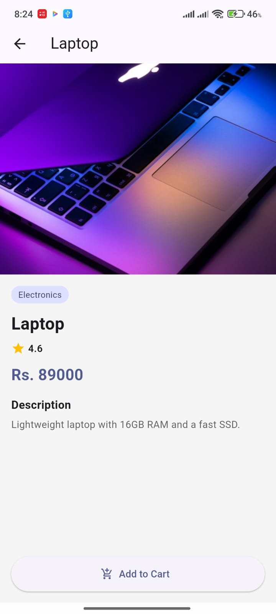

# Mini E-Commerce Application

**Student Name:** Samiyog bhujel  
**Student ID:** 2529566  
**Course:** Mobile Application Development – Flutter  

---

## Description
Mini E-Commerce is a multi-screen shopping app built with Flutter. The app allows users to browse promotional banners, filter products by category, view popular products, view detailed information for individual products, and add items to their shopping cart. It uses local static data and responsive UI components designed following Material Design guidelines.

---

## Features
- **App Bar:** Custom header with application title, search icon, and shopping cart icon.
- **Banner Carousel:** Auto-sliding banner carousel showcasing featured promotions and category links.
- **Category Navigation:** Horizontally scrollable list of product categories with custom icons and visual indicators.
- **Product Cards:** Reusable product cards featuring badges for *Sale* and *New* items, favorite toggles, ratings, prices, and high-quality product images.
- **Category Grid View:** Dedicated category page rendering products in a responsive grid (`GridView.builder`).
- **Product Details Screen:** Comprehensive details page showing full-size product image, price, rating badge, category name, detailed description, and an "Add to Cart" button.
- **Interactive Feedback:** Interactive SnackBar notifications when adding products to the cart or toggling favorites.

---

## Screenshots

| Home Page | Category Page | Product Details Page |
| :---: | :---: | :---: |
|  |  |  |

---

## Packages Used
- [carousel_slider](https://pub.dev/packages/carousel_slider) (`^5.1.1`): Used for building the auto-playing, swipeable banner carousel on the Home Page.

---

## How to Run

1. **Clone the Repository:**
   ```bash
   git clone https://github.com/samyogbhujel0108-debug/mini_ecommerce_flutter
   cd mini_ecommerce_flutter
   ```

2. **Generate Platform Folders (if needed) & Install Dependencies:**
   ```bash
   flutter create .
   flutter pub get
   ```

3. **Run the Application:**
   ```bash
   flutter run
   ```
